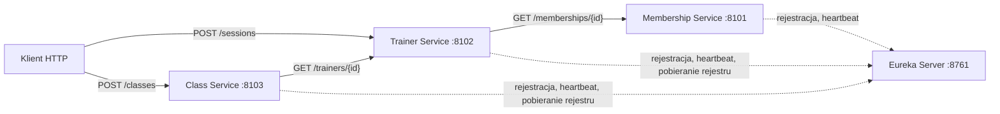
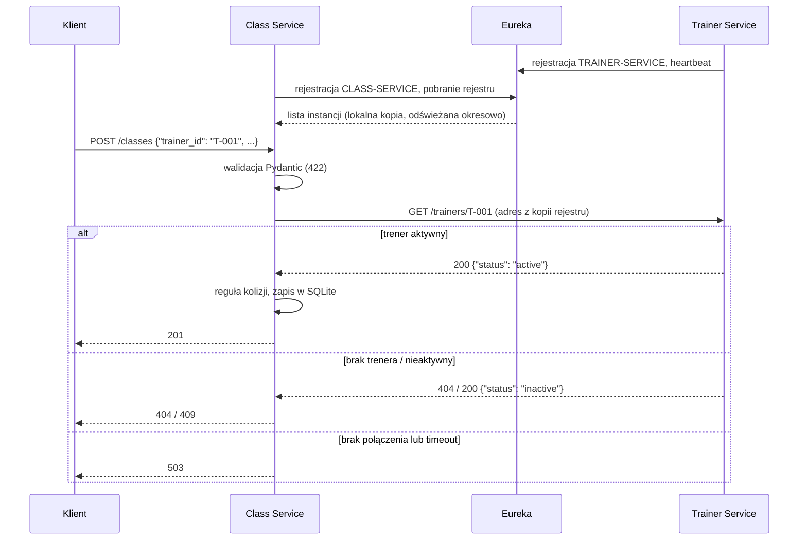

# Fitness Club — system mikrousług

Projekt przedmiotu „Projektowanie aplikacji webowych opartych o mikrousługi”. System zarządzania klubem fitness podzielony na niezależne usługi FastAPI, każda z własną bazą SQLite, cache Redis i rejestracją w Eurece.

| Usługa | Katalog | Port | Nazwa w Eurece | Odpowiedzialność | Autor | Dokumentacja LAB1–LAB2 |
|---|---|---:|---|---|---|---|
| Membership Service | `membership-service/` | 8101 | `MEMBERSHIP-SERVICE` | karnety członków i ich ważność | Dominik (LAB1), Julia (LAB2) | [README](membership-service/README.md) |
| Trainer Service | `trainer-service/` | 8102 | `TRAINER-SERVICE` | trenerzy, bloki dostępności, treningi personalne | Dominik | [README](trainer-service/README.md) |
| Class Service | `class-service/` | 8103 | `CLASS-SERVICE` | zajęcia grupowe, terminy, limity miejsc | Julia | [README](class-service/README.md) |
| Booking Service (planowana) | — | 8104 | `BOOKING-SERVICE` | zapisy na zajęcia, lista rezerwowa | Julia | — |

Każda usługa ma własne API, własną bazę (`app.db`, `trainer.db`, `class.db`) i własny prefiks kluczy w Redis. Żadna usługa nie czyta ani nie zapisuje tabel innej usługi — dane innej usługi pobiera przez jej API.

## Etap LAB3 — rejestracja i odnajdywanie usług

### Usługi i granice odpowiedzialności

| Usługa | Odpowiedzialność | Właściciel danych | Nazwa w Eurece | Port |
|---|---|---|---|---:|
| Membership Service | karnety członków, ich ważność, zawieszanie i wznawianie | tabela `memberships` (tylko ta usługa zapisuje) | `MEMBERSHIP-SERVICE` | 8101 |
| Trainer Service | trenerzy i ich status, bloki dostępności, treningi personalne | tabele `trainers`, `availability_blocks`, `training_sessions` | `TRAINER-SERVICE` | 8102 |
| Class Service | zajęcia grupowe: termin, prowadzący trener, limit miejsc, status | tabela `group_classes` | `CLASS-SERVICE` | 8103 |

W LAB3 działają dwa przepływy między usługami:
- **Trainer -> Membership:** przy umówieniu treningu personalnego (`POST /sessions`) Trainer Service sprawdza karnet. Karnet należy do Membership Service, więc Trainer Service przechowuje tylko `membership_id`.
- **Class -> Trainer:** przy tworzeniu zajęć grupowych (`POST /classes`) Class Service sprawdza, czy trener istnieje i jest aktywny. Trener należy do Trainer Service, więc Class Service przechowuje tylko `trainer_id`.

W obu przypadkach usługa wywołująca zna tylko **nazwę logiczną** usługi docelowej; jej adres pobiera z rejestru Eureka. Żądanie biznesowe nie przechodzi przez Eurekę — idzie bezpośrednio do odnalezionej instancji.



Linie ciągłe to żądania domenowe, przerywane — komunikacja z rejestrem. Baza SQLite i cache Redis każdej usługi pozostają jej prywatnymi zasobami z LAB2.

### Konfiguracja i uruchomienie

- **Wersje:** Python 3.12 lub nowszy (sprawdzone na 3.13.5), FastAPI, SQLAlchemy 2.0, redis-py, `py-eureka-client==0.13.3` (w `requirements.txt` każdej usługi). Eureka Server z pakietu pomocniczego LAB3: Spring Boot 4.1.1, Spring Cloud 2025.1.3, Java 21.
- **Adres Eureka Server:** `http://127.0.0.1:8761` (panel: http://127.0.0.1:8761/); klient używa `eureka_context="/eureka"`.
- **Sposób uruchomienia rejestru:** Docker Compose z pakietu `lab3-support` (obraz sam buduje serwer). Pakiet nie jest częścią repozytorium; należy go rozpakować obok, np. `D:\GitHub\lab3-support`.
- **Cykl życia klienta Eureki:** w każdej usłudze `create_app(database_url=None, redis_client=None, eureka_client=None)`. Dotychczasowy `lifespan` z LAB2 nazywa się `storage_lifespan`; nowy `lifespan` wykonuje kolejno: przygotowanie bazy i Redis -> `eureka_client.start()` (rejestracja) -> obsługa żądań -> `eureka_client.stop()` (wyrejestrowanie) -> zamknięcie Redis i bazy. Klient Eureki jest tworzony raz na instancję aplikacji w `app/eureka.py`; w testach wstrzykiwana jest atrapa `FakeEurekaClient`.

Konfiguracja instancji (zmienne środowiskowe, każda usługa w osobnym terminalu):

| Zmienna | Membership | Trainer | Class | Znaczenie |
|---|---|---|---|---|
| `EUREKA_SERVER_URL` | `http://127.0.0.1:8761` | `http://127.0.0.1:8761` | `http://127.0.0.1:8761` | adres rejestru, bez `/eureka` |
| `SERVICE_NAME` | `MEMBERSHIP-SERVICE` | `TRAINER-SERVICE` | `CLASS-SERVICE` | nazwa logiczna w Eurece |
| `SERVICE_PORT` | `8101` | `8102` | `8103` | port zgłaszany do rejestru — musi być równy `uvicorn --port` |
| `INSTANCE_IP` | `127.0.0.1` | `127.0.0.1` | `127.0.0.1` | adres osiągalny dla innych usług (domyślny) |
| `INSTANCE_HOST` | `localhost` | `localhost` | `localhost` | nazwa hosta w zgłoszeniu (domyślna) |
| `CACHE_PREFIX` | `lab2:album123456:membership-service` | `lab2:album123456:trainer-service` | `lab2:album123456:class-service` | prefiks kluczy Redis (LAB2) |

Wszystkie usługi czytają te same nazwy zmiennych, dlatego **każdą usługę uruchamiamy w osobnym terminalu** — inaczej usługa mogłaby zarejestrować się pod nazwą lub portem innej usługi. Nie ma sekretów; wszystkie adresy są lokalne.

Kolejność uruchomienia:

```powershell
# Terminal 1 — Redis (LAB2) i Eureka (w katalogu lab3-support)
docker start lab2-redis
docker compose up --build -d eureka        # pierwszy raz kilka minut
# panel: http://127.0.0.1:8761/

# Terminal 2 — Membership Service (w katalogu membership-service)
$env:EUREKA_SERVER_URL = 'http://127.0.0.1:8761'
$env:SERVICE_NAME = 'MEMBERSHIP-SERVICE'
$env:SERVICE_PORT = '8101'
$env:CACHE_PREFIX = 'lab2:album123456:membership-service'
.\.venv\Scripts\python.exe -m uvicorn app.main:app --port 8101

# Terminal 3 — Trainer Service (w katalogu trainer-service)
$env:EUREKA_SERVER_URL = 'http://127.0.0.1:8761'
$env:SERVICE_NAME = 'TRAINER-SERVICE'
$env:SERVICE_PORT = '8102'
$env:CACHE_PREFIX = 'lab2:album123456:trainer-service'
.\.venv\Scripts\python.exe -m uvicorn app.main:app --port 8102

# Terminal 4 — Class Service (w katalogu class-service)
$env:EUREKA_SERVER_URL = 'http://127.0.0.1:8761'
$env:SERVICE_NAME = 'CLASS-SERVICE'
$env:SERVICE_PORT = '8103'
$env:CACHE_PREFIX = 'lab2:album123456:class-service'
.\.venv\Scripts\python.exe -m uvicorn app.main:app --port 8103
```

Pierwsze uruchomienie usługi: w jej katalogu `python -m venv .venv` i `.\.venv\Scripts\python.exe -m pip install -r requirements.txt`. Usługi uruchamiamy bez `--reload`, żeby eksperymenty nie były zakłócane dodatkowymi restartami.

Testy automatyczne (każda usługa osobno, w jej katalogu; nie wymagają Eureki, Redis ani Dockera):

```powershell
.\.venv\Scripts\python.exe -m pytest -q
```

Zatrzymanie i reset: `Ctrl+C` w terminalach usług; `docker compose down` w `lab3-support` (Eureka); `docker stop lab2-redis`. Reset danych usługi: usunięcie jej pliku bazy (`app.db`, `trainer.db`, `class.db`) przy zatrzymanym procesie.

### Kontrakt komunikacji między usługami

#### Trainer → Membership

- **usługa wywołująca:** Trainer Service, w `POST /sessions`, przed sprawdzeniem reguł lokalnych i zapisem sesji (`app/membership_client.py`),
- **nazwa logiczna odnajdywanej usługi:** `MEMBERSHIP-SERVICE`,
- **metoda i ścieżka:** `GET /memberships/{membership_id}`, np. `GET /memberships/M-001`,
- **dane wejściowe i odpowiedź:** bez body; Trainer Service odczytuje z odpowiedzi tylko `id`, `status`, `valid_from`, `valid_to`,
- **obsługa błędów zależności:**

  | Sytuacja | Odpowiedź Trainer Service |
  |---|---|
  | karnet `active`, data treningu w okresie ważności | sprawdzenie reguł lokalnych, potem 201 |
  | karnet w innym statusie | 409 `Membership is not active (status '...')` |
  | data treningu poza `valid_from`–`valid_to` | 409 `Membership is not valid on the session date` |
  | Membership zwraca 404 | 404 `Membership not found` |
  | Membership zwraca inny błąd HTTP | 502 `Membership Service returned an HTTP error` |
  | odpowiedź bez wymaganych pól | 502 `Membership Service returned an invalid response` |
  | brak instancji, brak połączenia, timeout | 503 `Membership Service is unavailable` |

- **timeout wywołania:** 3 s (`timeout=3` w `do_service`).

#### Class → Trainer

- **usługa wywołująca:** Class Service, w `POST /classes`, po walidacji Pydantic, a przed sprawdzeniem kolizji trenera i zapisem (`app/trainer_client.py`),
- **nazwa logiczna odnajdywanej usługi:** `TRAINER-SERVICE`,
- **metoda i ścieżka:** `GET /trainers/{trainer_id}`, np. `GET /trainers/T-001`,
- **dane wejściowe i odpowiedź:** bez body; Class Service odczytuje z odpowiedzi tylko `id` i `status`,
- **obsługa błędów zależności:**

  | Sytuacja | Odpowiedź Class Service |
  |---|---|
  | trener `active` | sprawdzenie kolizji trenera, potem 201 |
  | trener w innym statusie | 409 `Trainer is not active (status '...')` |
  | Trainer zwraca 404 | 404 `Trainer not found` |
  | Trainer zwraca inny błąd HTTP | 502 `Trainer Service returned an HTTP error` |
  | odpowiedź bez wymaganych pól | 502 `Trainer Service returned an invalid response` |
  | brak instancji, brak połączenia, timeout | 503 `Trainer Service is unavailable` |

- **timeout wywołania:** 3 s.

Wspólne zasady obu przepływów: `strict_service_error_policy=False`, żeby 404 z usługi docelowej nie zamieniło się w błąd instancji; `HTTPError` jest obsługiwany przed `URLError` (jest jego podklasą); przy każdym błędzie zależności nic nie jest zapisywane, a odpowiedź nie zawiera tracebacku. Endpoint wywołujący jest `async def`, a synchroniczny zapis SQLAlchemy wykonuje się przez `run_in_threadpool`.

Przebieg rejestracji i żądania biznesowego (na przykładzie Class -> Trainer):



### Wyniki weryfikacji

Ręczne próby na prawdziwej Eurece (Docker Compose), Redis 7 w Dockerze, usługi bez `--reload`, każda w osobnym terminalu. Żądania przez `curl.exe -i` i Swagger UI (`/docs` każdej usługi).

#### Rejestracja

| Scenariusz | Stan początkowy i żądanie | Oczekiwany wynik | Wynik rzeczywisty | Przywrócenie stanu |
|---|---|---|---|---|
| Rejestracja | uruchomienie Eureki, potem Membership, Trainer i Class; odświeżenie panelu `http://127.0.0.1:8761/` | `MEMBERSHIP-SERVICE`, `TRAINER-SERVICE`, `CLASS-SERVICE` — każda `UP`, właściwe porty | zgodny: panel pokazuje `CLASS-SERVICE` (`127.0.0.1:class-service:8103`), `MEMBERSHIP-SERVICE` (`127.0.0.1:membership-service:8101`), `TRAINER-SERVICE` (`127.0.0.1:trainer-service:8102`) — każda `UP (1)`| — |
| Wyrejestrowanie | `Ctrl+C` w terminalu jednej usługi, obserwacja panelu | wpis znika po chwili (wyrejestrowanie przy poprawnym zamknięciu) | zgodny: po `Ctrl+C` w Trainer Service (13:22:57) wpis `TRAINER-SERVICE` zniknął z panelu o 13:23:55 — ok. 58 s | ponowne uruchomienie usługi |

#### Przepływ Trainer → Membership

| Scenariusz | Stan początkowy i żądanie | Oczekiwany wynik | Wynik rzeczywisty | Przywrócenie stanu |
|---|---|---|---|---|
| Odnajdywanie | wszystkie usługi `UP`; `POST /sessions` dla T-001, karnet `M-001`, termin w bloku dostępności | 201, sesja zapisana | WPISZ_WYNIK | usunięcie `trainer.db` |
| Brak zasobu | `POST /sessions` z `membership_id` `M-999` | 404 `Membership not found`, sesja nie powstaje | WPISZ_WYNIK | — |
| Reguła zależna od danych innej usługi | `POST /sessions` z karnetem `M-002` (`suspended`) | 409 `Membership is not active (status 'suspended')` | WPISZ_WYNIK | — |
| Awaria zależności | `Ctrl+C` tylko w Membership Service; ponowienie `POST /sessions`; `GET /health` Trainer Service | 503 `Membership Service is unavailable`; health Trainer nadal 200 | WPISZ_WYNIK | ponowne uruchomienie Membership |
| Ponowne uruchomienie usługi wywoływanej | uruchomienie Membership, oczekiwanie na odświeżenie rejestru, ponowienie żądania | ponownie 201 | WPISZ_WYNIK (po ilu sekundach) | — |

#### Przepływ Class → Trainer

| Scenariusz | Stan początkowy i żądanie | Oczekiwany wynik | Wynik rzeczywisty | Przywrócenie stanu |
|---|---|---|---|---|
| Odnajdywanie | wszystkie usługi `UP`; `POST /classes` z `trainer_id` `T-001`, termin bez kolizji | 201, zajęcia zapisane | zgodny: 201, `C-003`, `trainer_id` `T-001`, `scheduled`; w logu Trainer Service `GET /trainers/T-001` 200 | usunięcie `class.db` |
| Brak zasobu | `POST /classes` z `trainer_id` `T-999` | 404 `Trainer not found`, zajęcia nie powstają | zgodny: 404 `Trainer not found`; w logu Trainer Service `GET /trainers/T-999` 404; `GET /classes` bez nowych zajęć | — |
| Reguła zależna od danych innej usługi | `POST /classes` z `trainer_id` `T-002` (`inactive`) | 409 `Trainer is not active (status 'inactive')` | zgodny: 409 `Trainer is not active (status 'inactive')`; w logu Trainer Service `GET /trainers/T-002` 200 | — |
| Reguła lokalna po udanym odnalezieniu | `POST /classes` z `T-001` w terminie kolidującym z C-001 | 409 `Trainer already has a class at this time` | zgodny: 409 `Trainer already has a class at this time`; Trainer Service zapytany (`GET /trainers/T-001` 200), odrzucenie przez regułę kolizji Class Service; `GET /classes` zwraca tylko C-001, C-002, C-003 | — |
| Awaria zależności | `Ctrl+C` tylko w Trainer Service; ponowienie `POST /classes`; `GET /health` Class Service | 503 `Trainer Service is unavailable`; health Class nadal 200 | zgodny: Trainer Service zatrzymany (`Ctrl+C`); `POST /classes` (T-001, 2026-11-23 09:00–10:00) -> 503 `Trainer Service is unavailable`, zajęcia nie powstały; `GET /health` Class Service -> 200 `{"status":"ok","service":"class-service"}` | ponowne uruchomienie Trainer |
| Ponowne uruchomienie usługi wywoływanej | uruchomienie Trainer, oczekiwanie na odświeżenie rejestru, ponowienie żądania | ponownie 201 | zgodny: Trainer Service uruchomiony o 13:38:23; ponawiany `POST /classes` z tym samym body zwrócił 201 o 13:39:08 — ok. 45 s (czas odświeżenia rejestru w Class Service); wcześniejsze próby -> 503  | — |

#### Testy automatyczne

Testy nie łączą się z Eureką: każda usługa dostaje w `create_app(eureka_client=...)` atrapę `FakeEurekaClient` z asynchronicznymi metodami `start()`, `stop()` i (w usługach wywołujących) `do_service()`. Przepływy testowane są przez `httpx.AsyncClient` z `ASGITransport` i jawnym `app.router.lifespan_context(app)`.

| Usługa | Wynik `pytest -q` | Własne testy LAB3 |
|---|---|---|
| Membership Service | `17 passed` | `test_eureka_lifecycle.py` — start i stop klienta razem z aplikacją |
| Trainer Service | `49 passed` | `test_eureka_lifecycle.py`; `test_membership_discovery.py` — wywołanie po nazwie `MEMBERSHIP-SERVICE` i ścieżce, 404, 409 (status, okres ważności), 503 (`URLError`, `TimeoutError`), 502 (błąd HTTP, zła odpowiedź), 422 bez wywołania, reguła lokalna po udanym sprawdzeniu |
| Class Service | `31 passed` | `test_eureka_lifecycle.py`; `test_trainer_discovery.py` — wywołanie po nazwie `TRAINER-SERVICE` i ścieżce, 404, 409 (nieaktywny trener), 503 (`URLError`, `TimeoutError`), 502 (błąd HTTP, zła odpowiedź), 422 bez wywołania, reguła kolizji po udanym sprawdzeniu |

Wcześniejsze testy LAB1 i LAB2 wszystkich usług zostały zachowane i przechodzą z atrapą Eureki.

### Ograniczenia i dokumentacja

- **Niedostępny rejestr przy starcie usługi:** usługa i tak się uruchamia — `start()` klienta zapisuje w logu ostrzeżenia (`Eureka server ... is down`, `Register error! Will try in next heartbeat`) i ponawia rejestrację przy kolejnym heartbeat. Usługa wywołująca bez kopii rejestru nie znajdzie zależności i zwraca 503.
- **Niedostępny rejestr w trakcie pracy:** wywołania mogą dalej działać na wcześniej pobranej lokalnej kopii rejestru; zatrzymanie Eureki nie jest tym samym co zatrzymanie usługi. Sprawdzone: po `docker compose stop eureka` przy działających Class i Trainer Service `POST /classes` (T-001, 2026-11-24 09:00–10:00) zwrócił 201 (`C-005`) — Class Service użył zapamiętanej kopii rejestru z adresem Trainer Service. Kontener uruchomiono ponownie przez `docker compose start eureka`..
- **Wpis po zatrzymaniu usługi:** przy `Ctrl+C` klient wyrejestrowuje instancję, ale panel i kopie rejestru innych klientów aktualizują się z opóźnieniem (w naszej próbie ok. 58 s; w tym czasie panel pokazywał ostrzeżenie trybu self-preservation). Przy nagłej awarii wyrejestrowania nie ma — wpis może zostać do wygaśnięcia dzierżawy, a mechanizm self-preservation może wstrzymać jego usunięcie. W tym czasie wywołanie trafia pod nieczynny adres i kończy się 503.
- **Ponowne uruchomienie:** po starcie usługi wywoływanej pierwsze żądania mogą jeszcze dać 503, dopóki klient wywołujący nie odświeży lokalnej kopii rejestru.
- **Sprawdzenie a zapis nie są atomowe:** między odpowiedzią Trainer Service a zapisem zajęć trener może zostać zdezaktywowany (analogicznie karnet w przepływie Trainer -> Membership). Zdalne sprawdzenie nie blokuje danych innej usługi.
- **Cache po stronie usługi docelowej:** `GET /trainers/{id}` i `GET /memberships/{id}` są objęte cache Redis z LAB2. Po udanej zmianie statusu wpis jest unieważniany, ale po nieudanym unieważnieniu usługa wywołująca może przez TTL (60 s) dostać stary status.
- **Brak ponowień i circuit breakera:** zgodnie z zakresem LAB3 każde wywołanie to jedna próba z timeoutem 3 s.

Wykorzystana dokumentacja:

| Źródło (wersja) | Problem | Zastosowanie | Weryfikacja |
|---|---|---|---|
| [py-eureka-client — dokumentacja projektu](https://github.com/keijack/python-eureka-client), [wydanie 0.13.3 na PyPI](https://pypi.org/project/py-eureka-client/0.13.3/) | rejestracja usługi Python w Eurece i wywołanie innej usługi po nazwie, z obsługą 404 w kodzie endpointu | `EurekaClient(..., eureka_context="/eureka", strict_service_error_policy=False)` w `app/eureka.py`; asynchroniczne `start()`/`stop()` w `lifespan`; `do_service(nazwa, ścieżka, return_type="json", timeout=3)` w `membership_client.py` i `trainer_client.py` | panel Eureki pokazuje instancje `UP`; scenariusze 404 i 503 z tabel wyników; testy `test_*_discovery.py` |
| [Lifespan Events — FastAPI](https://fastapi.tiangolo.com/advanced/events/) i [Async Tests — FastAPI](https://fastapi.tiangolo.com/advanced/async-tests/) | uruchomienie i zatrzymanie klienta Eureki razem z aplikacją, po przygotowaniu bazy i Redis z LAB2; testy endpointów `async` z wykonanym lifespan | `storage_lifespan` zagnieżdżony w nowym `lifespan`; w testach `AsyncClient(transport=ASGITransport(app=app))` wewnątrz `app.router.lifespan_context(app)` | `test_eureka_lifecycle.py` w każdej usłudze (`starts == stops == 1`); logi Eureki: rejestracja przy starcie, `Cancelled instance` po `Ctrl+C` |
| [Eureka REST operations — Netflix](https://github.com/Netflix/eureka/wiki/Eureka-REST-operations), [Self Preservation](https://github.com/Netflix/eureka/wiki/Server-Self-Preservation-Mode) | zrozumienie rejestracji, heartbeat, wyrejestrowania i opóźnionego usuwania wpisów | interpretacja obserwacji z sekcji „Wyrejestrowanie” i ograniczeń | panel Eureki: wpis `TRAINER-SERVICE` znikał ok. 58 s po `Ctrl+C`; aktywny tryb self-preservation (ostrzeżenie „EMERGENCY!…”, Renews threshold 6, Renews last min 0); `docker compose stop eureka` nie przerwał wywołań Class -> Trainer |

- **AI:** Claude (Anthropic) — szkic klienta Eureki i mapowania błędów, testów z atrapą, fragmenty dokumentacji. Weryfikacja: uruchomienie testów wszystkich usług, ręczne scenariusze z tabel wyników na prawdziwej Eurece, porównanie kodu z instrukcją LAB3 i dokumentacją `py-eureka-client`, przeczytanie i omówienie kodu.

### Wkład autorów

- **Dominik:** poprawki po LAB2, rejestracja Membership i Trainer w Eurece, przepływ Trainer -> Membership z testami, scenariusze ręczne przepływu Trainer -> Membership.
- **Julia:** rejestracja Class Service w Eurece (`CLASS-SERVICE`, 8103) z testem cyklu życia; przepływ Class -> Trainer (`app/trainer_client.py`, mapowanie 404/409/502/503, 9 testów z atrapą); scenariusze ręczne przepływu Class -> Trainer; README.

**Oznaczenie wersji:** etap LAB3 oznaczony tagiem `lab3` na gałęzi `main`.
